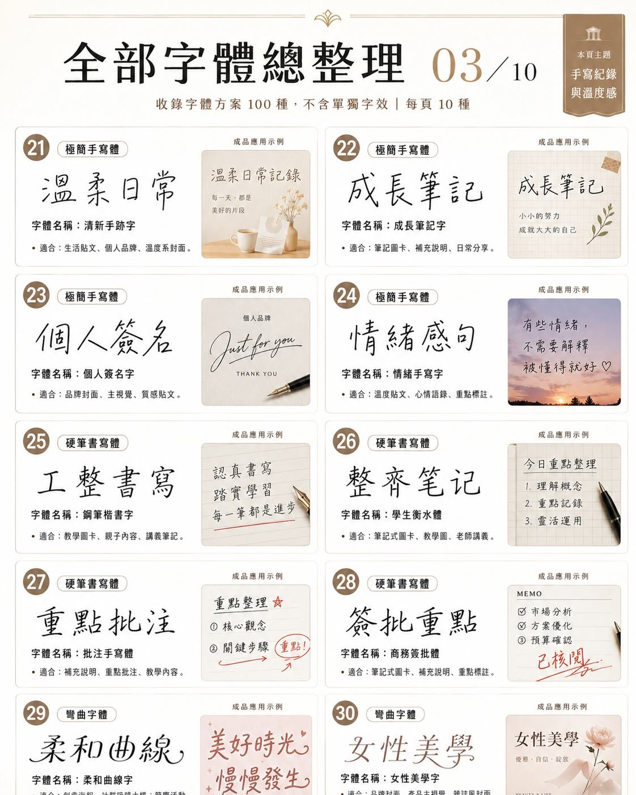
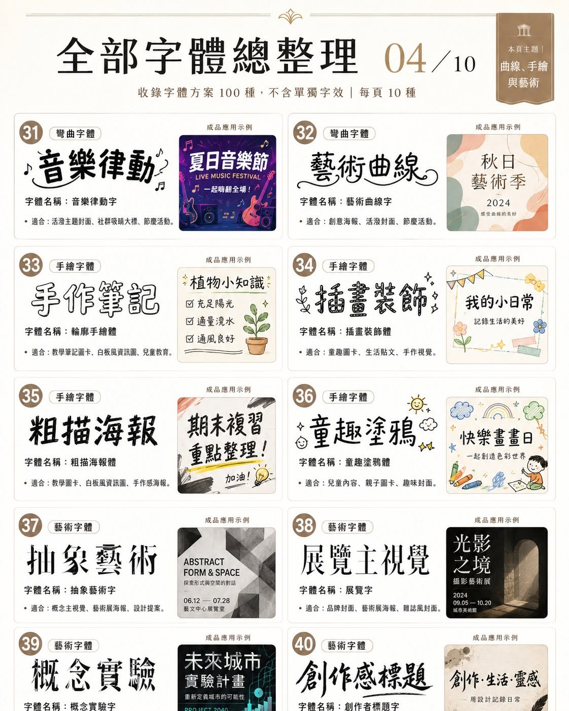
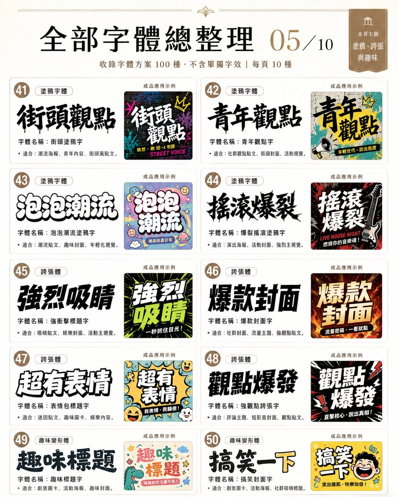
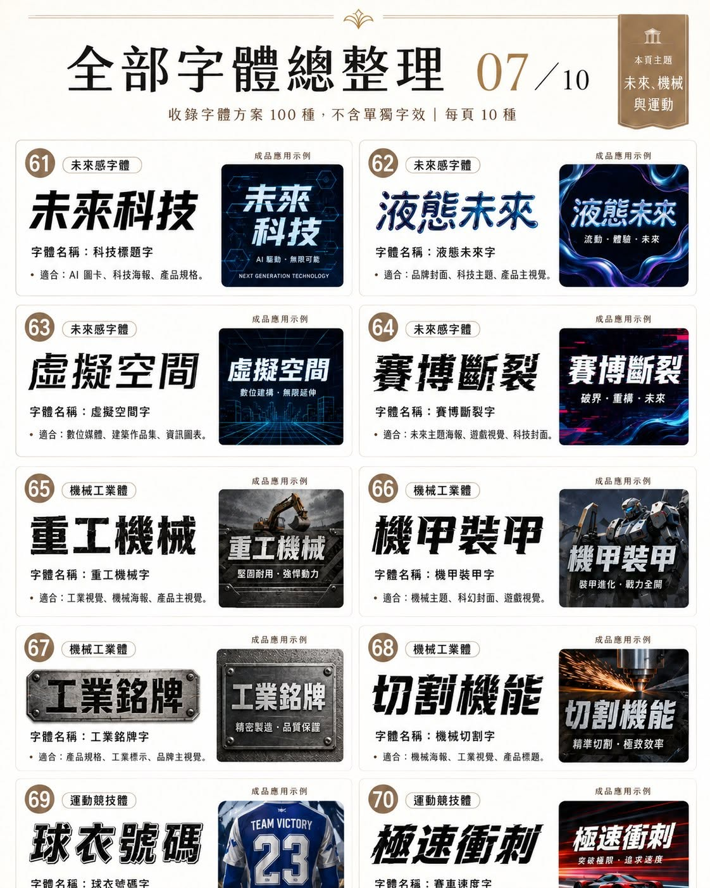
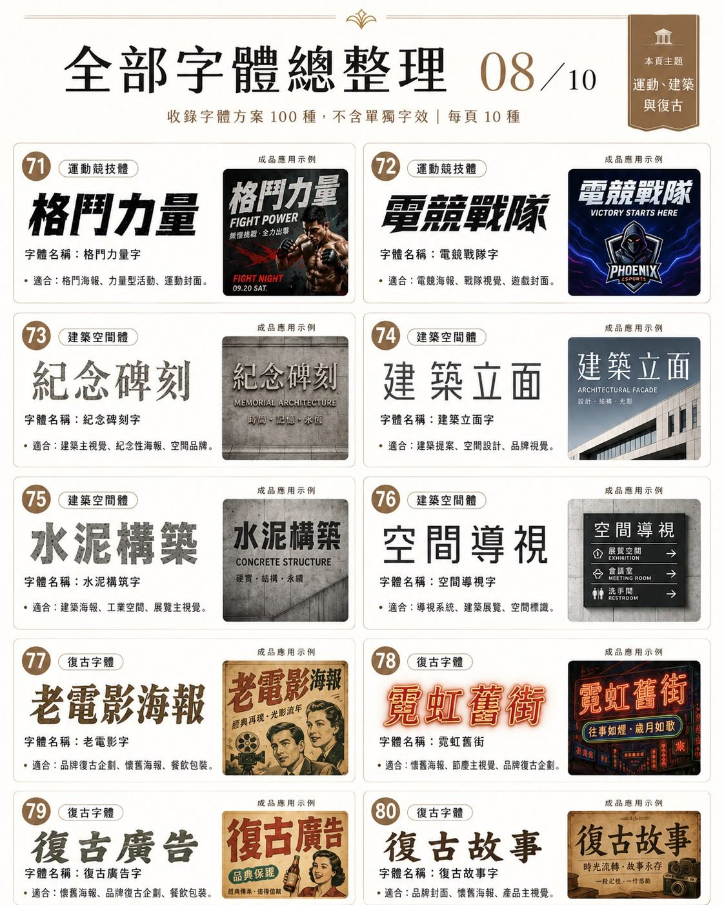
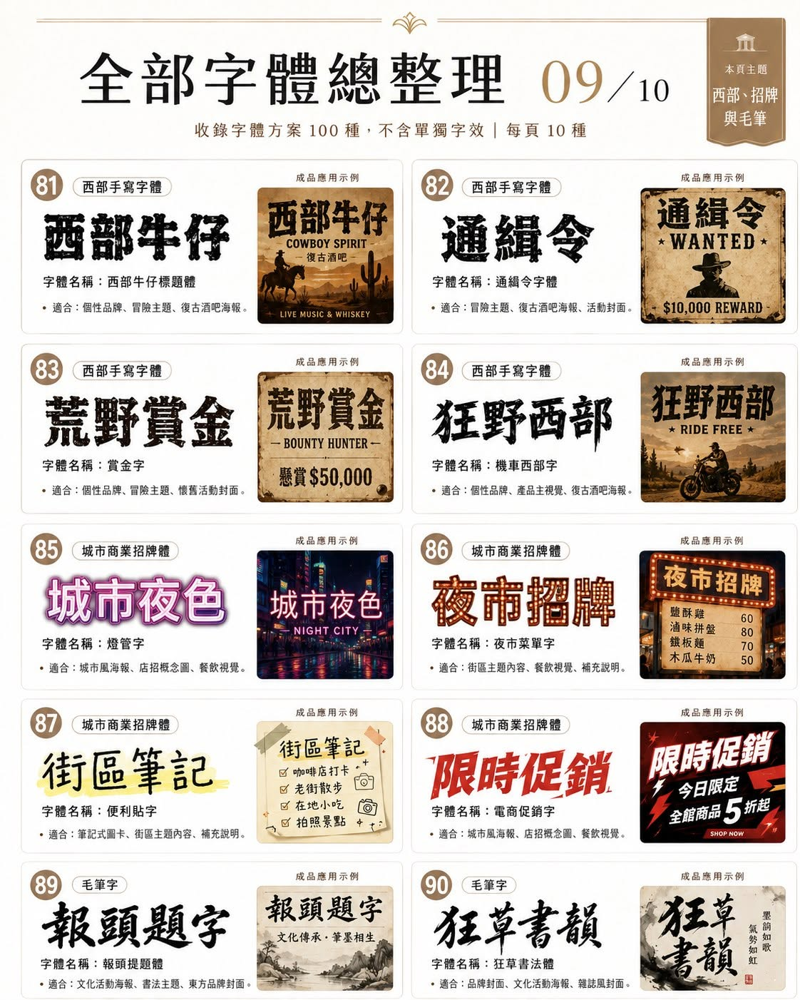
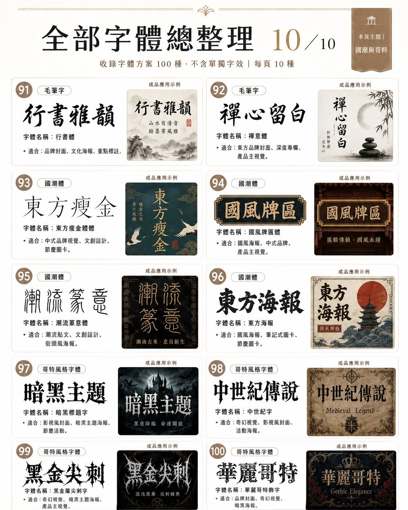

# AI 繪圖字體風格庫

**線上版（可搜尋，也能按一下複製提示詞）：https://yazelin.github.io/ai-font-styles/**

本庫從 100 種 AI 生圖用的「字體風格名稱」開始，每天自動擴充一種新風格，分成 10 類，並附上實際應用成品對照。

這裡整理的是可寫進提示詞的**字體風格描述詞**，方便製作圖卡、封面與海報時指定風格。描述詞能讓生成方向更明確，也比只說「幫我換一個好看的字」容易得到符合需求的結果。

## 提示詞用法

最快的方式：到線上版找到想要的字體，按一下「複製提示詞」。複製到的內容就是站上該效果圖使用的**同一段提示詞**，把 `[你的標題]` 這類方括號欄位換成自己的內容即可。

模板本體放在 `fonts.json` 的 `templates`（`pure` 純字、`app` 應用），網頁與每日產圖流程共用同一份。要調整提示詞時，直接修改該檔即可，避免兩邊內容不一致。以下幾句是效果關鍵，請保留：

- 「筆畫本身必須是〈風格描述〉所描述的實際形態或技法構成，不能只是在制式字體外觀上貼一層材質貼皮。」若少了這句，模型可能只會拿制式黑體貼上一層材質。
- 「共 N 個字，一字不多一字不少。」這句用來鎖定字數。
- 使用繁體字形，不得錯字、漏字或出現簡體字。
- 應用圖也要遵守構圖規則（要有真實輔助視覺與小字，不要做成置中對稱的簡報卡）。

自己從頭寫提示詞時，可參考以下骨架（站上首頁的「提示詞公式」區塊也採用同一份）：

```
[主題與場景描述]
主標題:「____」(共 N 個字,一字不多一字不少)
字體風格:____(不只是名稱,要描述材質與做法)
主標題的筆畫本身必須是這個風格描述的實際形態或技法構成,不能只在制式字體外觀上貼一層材質貼皮
[版型、情緒、輔助視覺與小字]
```

另外，站上每張圖都經過 Gemini 驗字，最多重生 3 次才會留下。自己生成的結果若不如預期，屬於常見情況，可以再試一次。

## 適用場景

- 社群貼文標題
- IG、FB 輪播封面
- 品牌與產品主視覺
- 知識圖卡與醫療衛教
- 活動、促銷及課程海報
- 童趣、復古、科技與潮流內容

## 實測效果圖

每種字體都有兩張實測生成圖（gpt-image 真實輸出，並非示意圖）：

- `samples/`：**純字效果**，以該風格呈現字體風格名稱本身，prompt 為「風格名稱＋一句風格描述」。
- `samples/apps/`：**應用效果**，把該字體套進真實設計場景，例如知識圖卡、雜誌封面、促銷廣告或遊戲海報，呈現迷你成品。

每 10 種合排一張的原稿放在 `samples/sheets/`（`sheet-*` 是純字，`app-sheet-*` 是應用圖）。完整生成 prompt 放在 `tools/gen-sheets.sh` 與 `tools/gen-app-sheets.sh`，錯字格單獨重生的修正 prompt 放在 `tools/gen-app-fixes.sh`，裁切與貼回腳本也都在 `tools/`。

線上版每個字體條目會並列顯示「字／應用」兩張效果圖，並提供兩個複製按鈕，分別複製填入該字體風格描述後的 `templates.pure` 與 `templates.app` 完整提示詞。

## 每日自動擴充

超過 100 種之後，本庫每天透過 GitHub Actions 自動擴充一種新字體（台北時間 10:30）：

1. 從 `queue.json` 候選佇列取出第一筆（名稱、風格描述與應用場景都已事先準備，佇列可隨時手動調整順序、刪除或新增項目）。
2. 呼叫自架的 [codex-image-service](https://github.com/yazelin/codex-image-service)，生成純字圖與應用圖。
3. Gemini 會檢查繁體字形、錯漏字與風格符合度。單圖最多重生 3 次，全部通過後才會上線。
4. 寫入 `fonts.json` 並提交，Pages 會自動更新。

重生 3 次仍不合格的字體會被移到佇列尾端，再換下一筆繼續處理（當天 13:30、16:30 還有兩個補跑時段），避免單一候選卡住整條產線。生圖服務掛掉時，workflow 會直接失敗，佇列維持原狀。驗字用的 Gemini 呼叫若遇到 5xx、429 或讀取逾時，最多呼叫 6 次，等待時間依序增加 30 秒。若仍無法連線，workflow 才會失敗。2026-09-02 曾因 Gemini 服務不穩定，三個時段都在第一次呼叫時中斷。

擴充字體在站上會標示「擴充」徽章，與阿吉原整理的 100 種明確區分。pipeline 程式位於 `tools/daily_font.py`。

候選佇列採低水位自動補貨：每日擴充完成後，`queue.json` 剩不到 14 筆時，workflow 會呼叫既有的 Gemini API 產生一批候選，並要求至少 20 筆有效項目。模型會參考現有分類數量，優先補足較少的分類。候選需符合佇列欄位格式，名稱會先正規化，再與 `fonts.json` 已完成清單、`queue.json` 現有候選及本批候選查重。驗證通過後才會一次寫入並提交；回覆格式錯誤、重複過多或有效數量不足時，原佇列不變，workflow 會沿用原本的 issue 提醒。

若自動補貨成功時有尚未關閉的「補候選」issue，workflow 會留言說明補入筆數並關閉 issue。補貨失敗時，workflow 仍會在佇列低於 14 筆時開 issue，供人工接手。

候選的 `desc` 要交代**筆畫如何構成**，例如線條走向、堆疊方式、鑲嵌結構或書寫筆觸，不能只寫材質形容詞。若風格隱含特定背景，例如黑板、液面或夜空，`desc` 也要點出來，避免生圖時退化成通用字體換皮，或與預設白底衝突。

候選也要提供 `headline`，也就是應用圖的主標題文字。`headline` 必須是 `app` 場景裡**實際會出現的一句標語**，例如電路板字可配「DEV CONF 2026」，不能只寫字體名稱「電路板字」。純字圖仍會以字體名稱作為展示文字。

## 字體總覽

每種字體的展示效果與「適合場景」請看對應圖卡。

### 01|商用基礎與品牌感


1. 極簡品牌字
2. 現代知識字
3. 清爽標題字
4. 科技簡潔字
5. 潮流品牌字
6. 高級雜誌字
7. 都市潮流字
8. 先鋒設計字
9. 溫柔細線字
10. 高級知識字

### 02|優雅襯線與細線


11. 未來細線字
12. 輕奢細線字
13. 雜誌襯線體
14. 商業襯線體
15. 輕奢封面字
16. 深度專欄字
17. 連續線稿體
18. 草圖單線體
19. 科技線框字
20. 優雅單線字

### 03|手寫紀錄與溫度感



21. 清新手跡字
22. 成長筆記字
23. 個人簽名字
24. 情緒手寫字
25. 鋼筆楷書字
26. 學生衡水體
27. 批注手寫體
28. 商務簽批體
29. 柔和曲線字
30. 女性美學字

### 04|曲線、手繪與藝術



31. 音樂律動字
32. 藝術曲線字
33. 輪廓手繪體
34. 插畫裝飾體
35. 粗描海報體
36. 童趣塗鴉體
37. 抽象藝術字
38. 展覽字
39. 概念實驗字
40. 創作者標題字

### 05|塗鴉、誇張與趣味



41. 街頭塗鴉字
42. 青年觀點字
43. 泡泡潮流塗鴉字
44. 爆裂搖滾塗鴉字
45. 強衝擊標題字
46. 爆款封面字
47. 表情包標題字
48. 強觀點誇張字
49. 趣味標題字
50. 搞笑封面字

### 06|童趣、課程與像素


51. 創意課程字
52. 兒童活動字
53. 兒童繪本體
54. 樂高玩具體
55. 零食包裝字
56. 剪紙拼貼字
57. 復古遊戲字
58. 街機遊戲字
59. 像素字
60. 方塊模塊字

### 07|未來、機械與運動



61. 科技標題字
62. 液態未來字
63. 虛擬空間字
64. 賽博斷裂字
65. 重工機械字
66. 機甲裝甲字
67. 工業銘牌字
68. 機械切割字
69. 球衣號碼字
70. 賽車速度字

### 08|運動、建築與復古



71. 格鬥力量字
72. 電競戰隊字
73. 紀念碑刻字
74. 建築立面字
75. 水泥構築字
76. 空間導視字
77. 老電影字
78. 霓虹舊街
79. 復古廣告字
80. 復古故事字

### 09|西部、招牌與毛筆



81. 西部牛仔標題體
82. 通緝令字體
83. 賞金字
84. 機車西部字
85. 燈管字
86. 夜市菜單字
87. 便利貼字
88. 電商促銷字
89. 報頭提題體
90. 狂草書法體

### 10|國潮與哥特



91. 行書體
92. 禪意體
93. 東方瘦金體
94. 國風牌匾體
95. 潮流篆意體
96. 東方海報
97. 暗黑標題字
98. 中世紀字
99. 黑金屬尖刺字
100. 華麗哥特飾字

## 來源

圖卡與字體名稱整理來自「數位生活小記 阿吉」的 Facebook 粉絲團貼文《做圖卡不要只顧漂亮。|第四篇》，歡迎追蹤：https://www.facebook.com/profile.php?id=61589913332541

本 repo 僅作提示詞參考整理，內容著作權歸原作者所有。

---

整理：[GitHub](https://github.com/yazelin) | [Facebook](https://www.facebook.com/yaze.lin.gm) | [Buy Me a Coffee](https://buymeacoffee.com/yazelin)
